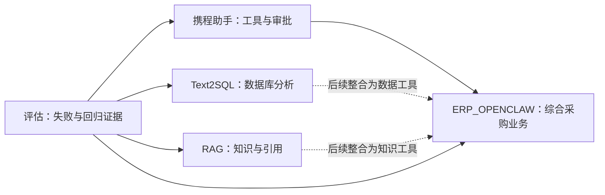

# Agent-Learning

**四个关联项目统一放在 [repos/ 项目文件夹](repos/) 下，从工具调用、知识检索和数据库分析，逐步学到 ERP_OPENCLAW 综合业务 Agent。**

```text
Agent-Learning/
├── repos/
│   ├── agent_ctrip_assistant/  # 携程助手：工具、路由与审批
│   ├── RAG/                    # 企业知识库：检索与引用
│   ├── Text2SQL/               # 采购数据分析：自然语言查数
│   └── ERP_OPENCLAW/           # 综合采购平台：Agent 与业务流程
├── docs/                       # 学习路线、项目关系与使用说明
└── learn.py                    # 统一下载、演示与验证入口
```

在 GitHub 打开 **[repos/](repos/)**，即可一起看到四个项目。点击项目目录会进入原仓库的固定版本；各项目的独立仓库、提交历史和章节标签继续保留。目录关联用于统一浏览与下载，业务接口的后续整合仍按学习路线推进。

[](https://github.com/ooo1208/Agent-Learning/actions/workflows/quality.yml)

这是学习总入口，通过 Git 子模块将下面四个仓库放入同一目录。三个入门工程可用 Python 3.11+ 离线运行；ERP 另有 Java、前端和服务依赖。

| 顺序   | 仓库                                                                        | 核心练习 | 章节 |
|------|---------------------------------------------------------------------------|---|---|
| 1    | [agent_ctrip_assistant](https://github.com/ooo1208/agent_ctrip_assistant) | 工具调用、预订提案、人工审批、状态恢复 | 6 章 |
| 2    | [RAG](https://github.com/ooo1208/RAG)                                     | 文档入库、词法检索、引用、可选向量和混合检索 | 6 章 |
| 3    | [Text2SQL](https://github.com/ooo1208/Text2SQL)                           | 采购指标、真实 SQLite 查询、只读约束与执行预算 | 6 章 |
| 4    | [ERP_OPENCLAW](https://github.com/ooo1208/ERP_OPENCLAW)                   | Java ERP、MCP、DeepAgents、Skills、人工介入与异步评估 | 14 章 |
| 4贯穿  | ---- [评估学习说明](docs/evaluation.md)                                         | 失败例、评分、回归门禁、运行追踪 | 使用 ERP 已有评估模块 |


# 项目之间的关系

求职作品可以最终收敛为 **ERP_OPENCLAW 综合采购平台 + 企业知识库 RAG**。
携程项目用于建立基础；
Text2SQL 可逐步接入采购分析。图中的整合箭头是后续练习，当前独立教学仓库还没有自动接入 ERP；
RAG 中 OCR/GME/Milvus 等多模态内容仍是进阶计划。


# 项目文件夹使用说明----repository-folders.md 项目文件夹使用说明：下载、更新与保留修改

打开 [Agent-Learning 的 repos/](../repos/)，可以一起浏览携程助手、RAG、Text2SQL 和 ERP_OPENCLAW。它们通过 Git 子模块关联到总仓库：本地下载后表现为四个项目目录，在 GitHub 点击目录则进入对应原仓库的固定提交。

每个项目仍保留自己的提交历史、章节标签和独立地址。总仓库记录每个项目选用的版本，便于复现同一套学习环境；它不会自动追随各项目上游的最新提交。这是 Git 子模块的标准行为，详见 [Git 子模块说明](https://git-scm.com/docs/gitsubmodules)。

## 首次下载全部项目

先安装 Git 和 Python 3.11+：

```sh
git clone --recurse-submodules https://github.com/ooo1208/Agent-Learning.git
cd Agent-Learning
python learn.py verify
```

`--recurse-submodules` 会将四个项目一起下载到 `repos/`。验证默认运行三个教学项目的离线检查；ERP 服务安装和运行仍需遵循其 README。递归克隆不会安装 Java、数据库、模型服务或其他 ERP 依赖。

GitHub 的普通 ZIP 下载不包含子模块源码。若需要完整学习工程，使用递归克隆命令。

## 已经普通克隆过总仓库

进入现有的 `Agent-Learning` 目录，可以继续使用原来的下载入口：

```sh
python learn.py clone
```

它只下载或初始化携程助手、RAG、Text2SQL 三个教学项目。需要全部四个项目时执行：

```sh
python learn.py clone --with-erp
```

脚本保留已有项目和修改；如果当前版本不符合总仓库的记录，按输出提示处理，不会强行覆盖学习代码。

## 更新已下载的项目

先保存总仓库和各子项目中的修改。准备自己写代码时，先在相应子项目中新建学习分支，再修改并提交，避免切换固定版本时遗漏个人工作。子模块初始化后通常处于固定提交，而非某个开发分支。

在总仓库目录执行：

```sh
git pull --ff-only
git submodule update --init --recursive
```

第一条命令取得总入口的更新，第二条将项目目录更新到总入口记录的版本。不要加 `--force`；如果 Git 提示本地修改或分支冲突，先保存和处理自己的工作。命令含义见 [git submodule 官方文档](https://git-scm.com/docs/git-submodule)。

## 修改子项目并发布

先进入对应项目，在自己的分支完成修改、验证、提交并推送。随后回到总仓库，更新该项目的引用及相应版本记录，再提交、推送总仓库。这样别人从总入口下载时，能够取得已经公开的子项目版本。

若只想学习已有章节，可以按各项目 README 中的 `chapter-NN` 标签查看历史版本；本次整理没有重写原有章节或新增虚构章节。

## 目录关联与业务整合

这个文件夹把学习工程和版本组织在一起。
Text2SQL 接入 ERP 数据工具、
RAG 接入采购知识查询，仍属于 [学习路线](learning-path.md) 中的后续整合任务；统一目录并不代表这些接口已经连接完成。


# 快速开始
先安装 Python 3.11+ 和 Git。在终端执行：
```sh
git clone --recurse-submodules https://github.com/ooo1208/Agent-Learning.git
cd Agent-Learning
python learn.py verify
python learn.py demo all
```

递归克隆会一次下载四个项目的固定版本。GitHub 普通 ZIP 下载不包含子模块源码，请优先使用上面的命令。下载代码不会自动安装或启动 ERP 服务。

如果此前使用普通 `git clone`，仍可执行 `python learn.py clone` 下载或初始化三个入门工程；执行 `python learn.py clone --with-erp` 可包含全部四个项目。脚本会保留已有工作目录和修改，不会强行覆盖；已有版本与记录不一致时，请按提示处理。更新已有总仓库和子项目的步骤见 [项目文件夹使用说明](docs/repository-folders.md)。

离线演示和测试不调用模型，不需要密钥。演示使用合成数据；测试通过不表示真实模型问答效果已经验收。

想学习 ERP 时，按照 `repos/ERP_OPENCLAW/README.md` 安装其独立依赖。`python learn.py verify --include-erp` 仅额外运行 ERP 的合成评估门禁，并不替代完整 ERP 集成测试。

每个仓库都有中文 README、来源说明、章节文档和 `chapter-NN` 标签。切到标签前先保存自己的改动；可以另建目录学习某章：

```sh
git -C repos/RAG worktree add ../../RAG-chapter-03 chapter-03
```
章节是本次按知识依赖重新编排并提交的教学顺序，使用真实提交时间，不是官方课程原目录。各章覆盖范围以相应 README 为准。


# ----学习路线
| 阶段 | 学习内容 | 完成标准 |
|---|---|---|
| 1 携程 | 数据查询→预订提案→审批→路由→模型工具协议→测试 | 能演示拒绝、重启恢复、重复审批和库存变化，并解释为什么模型不能批准自己的提案 |
| 2 RAG | 文档读取→切片入库→关键词检索→混合检索→引用回答→评估 | 自建有答案/无答案题集，定位召回错误，解释有效引用 ID 与真实语义支持的区别 |
| 3 Text2SQL | 建库与口径→SQL 执行→访问控制→查询预算→模型接入→验收 | 能查到实际数据，阻止写入和越权，解释金额、收货率和延期天数的口径 |
| 4 ERP | 业务服务→MCP→Agent→Skills/上下文→审批/异步→评估 | 独立跑通业务演示，定位工具错误，说明状态持久化、任务恢复与人工介入 |
## 后续整合练习
先把 Text2SQL 的只读查询封装成独立 MCP 工具，
再考虑把 RAG 的检索和引用封装成知识工具。共享的是业务口径和接口契约，不应直接绕过各自的访问控制。每次整合增加成功、失败和权限案例，并记录模型和配置。
多模态 RAG、Agentic RAG 的循环检索与重排序是后续任务；不将当前词法演示描述成已完成这些进阶能力。


# ----ERP 模块与基础项目对应：：两个最终作品与基础工程

| 最终作品                | 模块             | 基础工程与来源 |
|---------------------|----------------|---|
| ERP_OPENCLAW 综合采购平台 | 对话入口、路由、缺字段追问  | 携程单/多 Agent 学习材料与本地携程教学工程 |
| ERP_OPENCLAW 综合采购平台 | 任务拆解、上下文和阶段提示  | 现有 DeepAgents/Harness 工程及其章节文档 |
| ERP_OPENCLAW 综合采购平台 | 库存、订单、供应商数据分析  | Text2SQL 教学工程；后续作为业务工具接入 |
| ERP_OPENCLAW 综合采购平台 | 业务执行           | 已有 Java ERP 和 MCP |
| ERP_OPENCLAW 综合采购平台 | 人工审批、避免重复操作、恢复 | 携程审批练习与现有 ERP 状态流程 |
| ERP_OPENCLAW 综合采购平台 | 制度与资料依据        | RAG 教学工程；后续作为知识工具接入 |
| 企业知识库 RAG           | 解析、切片、来源定位     | 基础 RAG 教学工程 |
| 企业知识库 RAG           | 检索、融合、引用校验     | BM25、可选 embedding/RRF、可选生成接口 |
| 企业知识库 RAG           | 多模态、查询改写与循环检索  | GME、OCR、Agentic RAG 公开资料；目前为进阶任务 |
| ----追踪、评分、回归门禁  |                | ERP现有评估模块、Langfuse 与 RAGAS 公开文档 |
## ERP 的 14 章可以分五轮读：
1. 第 01—03 章：业务模型、Java ERP 和 MCP；理解模型最终如何触达数据和操作。
2. 第 04—06 章：多Agent、沙箱、Skills 和长期记忆；理解职责和能力范围。
3. 第 07—09 章：上下文、审批、、、、异步任务；理解长任务状态。
4. 第 10—12 章：证据、观测、、、指标与异步评估Worker、、、与回归门禁。
5. 第 13—14 章：Web工作台、部署和完整验证。


# 学习与资料
- [LangGraph 官方历史 notebook](reference/LangGraph-Customer-Support/customer-support.ipynb)：附原许可证、固定提交和 SHA256；未执行其历史依赖。
- [15 条公开教学资料及原厂参考](README的视频来源SOURCES--资料索引.md)
- ----
- [从 GitHub 下载后的验收记录](docs/verification.md)：40 项测试，6 项运行检查。
- [实验记录模板](实验记录模板.md)
- | 4贯穿  | ---- [评估学习说明](docs/evaluation.md)| 失败例、评分、回归门禁、运行追踪 | 使用 ERP 已有评估模块 |
总入口自己的三个章节标签分别对应路线与资料、带许可的原始参考 notebook、可复现运行工具与 CI。文件夹关联作为后续维护提交保留，原有章节标签不变。它是四个项目的导航与下载入口。
