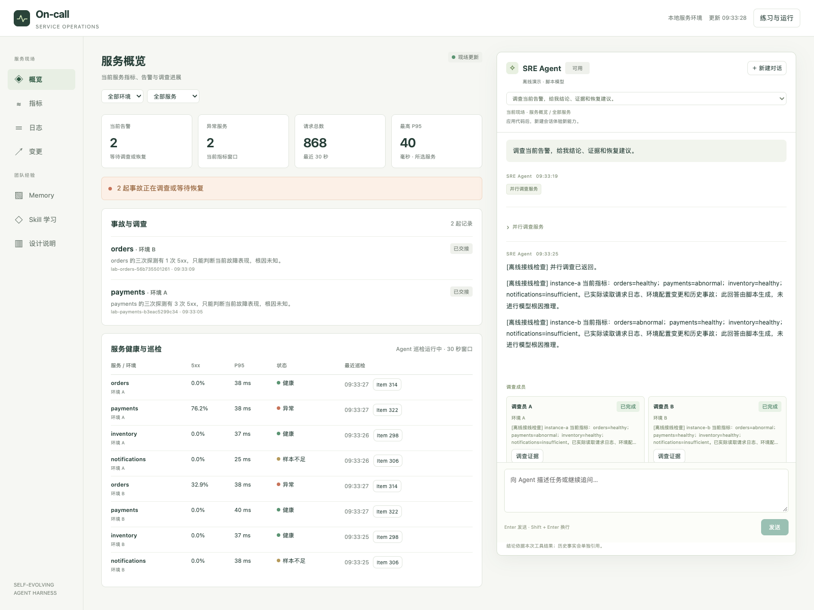

----git课程代码仓库：：https://github.com/tylerelyt/self-evolving-agent-harness
----课程：：极客时间：：https://time.geekbang.org/column/intro/101188801 ----
自进化 Agent 工程实战
从看懂 Harness，到塑造数字分身
Tyler  国内头部大模型团队算法负责人
总榜 第6名
已完结·共31讲----2873 人已学----收藏


## ----收获：：学完你会获得什么
Harness 机制理解。理解任务、上下文、状态和权限如何共同影响 Agent 行为。遇到执行偏离或效果波动时，知道从哪里检查、该调整哪一层机制。
一个亲手实现的自进化 On-call Agent。结合配套代码，串起持续运行、人工介入、结果验收和任务后复盘，为迁移到自己的业务场景建立实践基础。
【】一套把工作经验转化为 Agent 能力的方法。学会提炼和维护 Memory、设计和演化 Skill，让成功、失败与人工纠正成为后续任务可以利用的资产。
【】一条能够验证效果、管理版本和撤回错误的进化闭环。掌握新旧方法比较、离线优化和共享治理，既能推动 Agent 学习，也能判断它是否真的变好了。
当你下一次纠正 Agent 时，可以进一步让这次纠正成为经过验证的方法；当你把一项工作交给它时，也能把目标、边界和验收留在系统里。从看懂 Harness，到塑造会学习的数字分身，你将逐步把自己的工作方法转化为 Agent 能够执行、复用和持续改进的能力。


## ----课程的五个篇章
### 第一部分：初识 Harness，看懂一句要求怎样变成连续行动
从 Codex 入手，拆解 Agent Loop、运行时控制和上下文引擎。
你会看见 Agent 怎样决定下一步、调用工具并处理返回结果，也会理解工作中的新消息何时生效、模型每一轮究竟能看见什么。由此建立对 Harness 的整体认识，找到工程师能够干预任务的关键位置
### 第二部分：长程运行，让 Agent 带着目标、方法和边界持续工作
当任务持续几十轮、几百轮，怎样压缩历史而不丢失关键线索？怎样借助旧经历开启新的调查？怎样让规则持续生效，又避免把所有资料塞进上下文？这一部分将串起 AGENTS.md、上下文压缩、会话分支、Skill 和渐进披露，再通过隔离与审批限定行动范围。你将理解人类的提醒、守候和叫停，如何逐步由 Harness 系统机制承接。
### 第三部分：经验回流，让一次工作留下可复用的事实和方法
从这一部分开始，课程转向 Hermes，观察任务结束后的后台复盘与学习。
“日志已迁移到新入口”应该怎样写入 Memory？
一次有效的故障排查，怎样提炼成 Skill？
环境变化以后，旧记忆如何修正，老方法如何更新？
你将沿着后台复盘、记忆维护、历史会话检索、外部知识接入和 Skill演化，理解Agent怎样从完成任务走向积累经验。
### 第四部分：可信可控，让新方法经得起验证，也退得回旧版本----受控递归自我改进（RSI）闭环
经验越来越多，技能库怎样整理？新 Skill 在当前任务中有效，换个场景还能用吗？
一次修改改善了部分结果，会不会损害原有能力？
课程将讲解 Skill Curation、业务 Eval、A/B 测试、安全恢复和离线优化。
你会学习利用一批任务比较新旧方法，让改进经过评测、审批和版本管理，再进入后续运行。当运行持续产生经验，经过验证的经验又持续改善运行，就形成了课程所讨论的受控递归自我改进（RSI）闭环。
### 第五部分：群体进化，让一个 Agent 学到的方法成为团队能力
借助 SkillClaw，进一步观察不同 Agent 的经历怎样汇集、去重和验证，以及共享 Skill 怎样按岗位、项目和权限边界进入下一班值守。
最后，将这些机制组装成完整的自进化 On-call Agent：能够持续工作，提出经验更新，通过评测引入新能力，并在效果退化时回滚。
贯穿课程的能力进度是：连续行动 → 长程值守 → 积累经验    →改进→验证→    共享能力。每一步都对应具体的工程问题，带你结合真实挑战，掌握自进化 Agent 设计方案。


## ----课程目录
### ====开篇词 (2讲)
开篇词｜从看懂 Harness，到塑造会学习的数字分身
时长 09:26
直播回放｜从独立作业到经验成长：企业 Agent Harness 落地指南
时长 41:08
### ====第1部分：初识 Harness (3讲)
01｜Agent 执行引擎：一句话怎样变成连续行动?
时长 14:43
02｜一封迟到的信：怎样改变一个正在工作的 Agent？
时长 12:06
03｜上下文引擎：模型每轮对话都会看见什么？
时长 10:16
### ====第2部分：长程运行 (6讲)
04｜AGENTS.md：如何设计规则指导 Agent 未来行动
时长 11:32
05｜上下文压缩：如何压缩历史才不影响任务延续？
时长 13:06
06｜会话分支：怎样借助旧经历，开始一场新的调查？
时长 09:08
07｜经验技能化：怎样把一次排查经历提炼成可复用的方法？
时长 09:22
08｜渐进披露：按需调阅关键上下文
时长 09:18
09｜令行禁止：用隔离与审批守住授权边界
时长 11:05


### ====第3部分：经验回流 (7讲)
10｜原生学习：Hermes 与递归自我改进
时长 10:19
11｜幕后复盘：Hermes 为什么回答以后还在忙？
时长 10:48
12｜记忆维护：Hermes 怎样修正过时的记忆？
时长 07:08
13｜会话还原：Agent 怎样按需核对自己的旧记录
时长 07:38
14｜海纳百川：Agent 怎样用上企业知识与共享经验？
时长 09:14
15｜自主 skill 学习：从完成任务到领悟方法
时长 07:37
16｜增量 Skill 演化：Agent 服务怎样持续适应新需求？
时长 09:06
### ====第4部分：可信可控 (4讲)----受控递归自我改进（RSI）闭环
17｜Skill Curation：方法越积越多，谁来整理整个技能库?
时长 09:21
18｜业务 Eval：怎样用对照评测为 Skill 自进化把关？
时长 11:09
19｜企业数据集：怎样用 Langfuse 把真实经历变成可重跑的评测题？
时长 10:36
20｜离线优化：怎样利用一批任务，自动寻找更好的 Skill？
时长 10:52
### ========第5部分：群体进化 (5讲)
                21｜SkillClaw（上）：怎样从多个在线 Agent 的经历中蒸馏 Skill？
                时长 13:15
                22｜SkillClaw（下）：怎样将演化后的 Skill 分发给其他 Agent？
                时长 09:20
                23｜自进化 Oncall Agent：把每一层接成一条线
                时长 06:16
                综合实战｜让 Oncall Agent 在生产环境中持续成长
                时长 19:38
                思考题答案合集｜对答案的过程，比答案本身重要
                时长 24:06
### ====前沿速递 (2讲)
加餐 01｜从 Agent 到数字员工：Hermes Gateway背后的运行时架构演进
时长 11:52
加餐 02｜让数字员工组成协作团队：Hermes Group Chats 的多 Agent 协作机制
时长 10:47
### ====结束语 & 结课测试 (2讲)
结束语｜不要温和地走入那良夜
时长 08:57
结课测试｜来赴一场满分之约！
时长 00:30


## ----课程评价
chat窗口中，如何实现这四种控制意图
 作者回复：如果问的是具体操作，以 Codex 为例：
任务运行过程中继续发送消息，可以通过 Steer 让新要求介入当前 Turn；
选择 Queue，则把消息留到当前任务结束后再处理；
Interrupt 对应取消当前正在执行的 Turn，但保留已经产生的修改；
Stop 则是停止整个调度或运行时，不再继续后续动作。
具体到界面上，有些是输入框里的后续消息行为，有些通过停止/中断按钮完成，有些则通过 API 控制，并不一定分别对应四个独立按钮。这四个词更准确地说是 Harness 的四种控制意图，不同 Harness 的 UI 映射会有所不同。
课程里我们其实更希望大家逐渐采用 Headless 的方式使用 Harness，因为脱离 Chat UI 以后，这些控制意图会更加清晰地体现为运行时的状态管理和控制接口，也更接近企业里把 Agent 接入后台服务、流水线和自动化系统时的真实使用方式。
##===================================##===================================##===================================
##===================================##===================================##===================================
##===================================##===================================##===================================
##===================================##===================================##===================================
# 动手学习自进化智能体
让 Agent 在持续运行中积累经验、改进方法，并把改进带到后续任务。
从持续巡检的 On-call Agent 开始，动手串起任务执行、记忆维护、Skill 演化、评测与发布。23 个独立实验分别拆解其中的机制，
综合 Workshop 将它们接成支持持续运行的系统。
模型原理、调用接口与 Agent 基本结构，可从[动手学习大模型系统](https://github.com/tylerelyt/llm-sys-workshop)入手。


## Run
需要 Git、Bash、make，以及 **uv 或 Python 3.12**。首次安装需要联网；演练不需要 API key。

```bash
git clone https://github.com/tylerelyt/self-evolving-agent-harness.git
cd self-evolving-agent-harness
make setup
make demo
```

这会运行两个真实 Hermes、两套 HTTP 环境与原生 SkillClaw：注入故障 → 调查 → 交接 → 恢复 → 演化 → 评测 → 发布 → 新任务采用 → 回退。模型响应和候选修订由固定脚本驱动，远程模型调用为 0；两轮恢复窗口需要等待数分钟。

末尾输出来自这次实际运行：

```text
paired replay: baseline 1/3 -> candidate 3/3
round 1: publish; round 2 adopted: True
instance-a: [503, 200]
instance-b: [503, 503]
rollback: completed
closed_loop_verified: True
evidence: .../report.json
```

## Change something

| 你要改什么 | 直接打开 |
| --- | --- |
| 巡检与故障调查的方法 | [On-call Skill](workshop/capstone/patrol/skills/oncall-alert-triage/SKILL.md) |
| 告警、分支、通知、记忆与放行逻辑 | [六个函数的练习](workshop/capstone/lab/self_improvement_agent.py) · `make lab` |
| 发布与回退的完整执行链 | [self_improvement_agent.py](workshop/capstone/self_improvement_agent.py) |
| 新旧版本为何通过或被拒绝 | [评测门槛](workshop/capstone/patrol/fleet_eval.py) |

脚本模型只支持固定场景；任意自然语言规则修改使用在线模型验证。

`make ui` 打开完整系统工作台；`make check` 运行零模型回归。模型演示、在线模型和真实协议执行的区别及配置见[运行参考](workshop/capstone/RUNNING.md)。

[](workshop/capstone/README.md#启动本地工作台)

上图使用脚本模型。运行自己的工作台用 `make ui`。

## 逐讲练习

[01—23 实验目录与关键词](examples/README.md) · [Codex Notebook 环境](examples/CODEX.md) · [课程](https://time.geekbang.org/column/intro/101188801)

## 独立综合实战

[On-call Workshop](workshop/capstone/README.md)：从六个函数开始搭建，最后用同一份实现验证完整闭环。

## 运行系统

[持续值守与故障注入](workshop/capstone/RUNNING.md#双实例持续值守) · [生产扩展](workshop/capstone/PRODUCTION-DESIGN.md) · [参与开发](CONTRIBUTING.md)。长期服务与有界演练使用不同入口。

## 运行说明

[命令、在线模型与证据](workshop/capstone/RUNNING.md) · [平台条件](COURSE_MAP.md) · [MIT](LICENSE)
